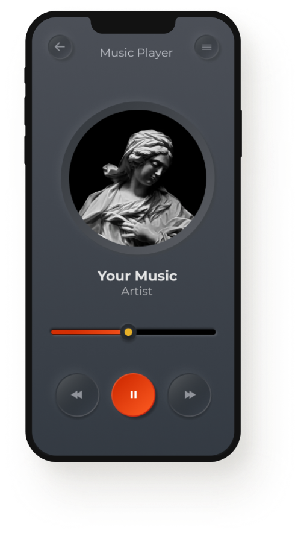

# 🎧 Music Player — лендинг

Адаптивный лендинг музыкального сервиса: большой hero-блок с мокапом приложения, секции «Music», «About», «Store» и футер.

**🔗 Демо:** https://uzakilaa.github.io/music-player/

## Стек
- HTML5 (семантическая разметка)
- CSS3: Flexbox, абсолютное позиционирование, медиазапросы
- Google Fonts (Poppins, Stardos Stencil)

## Что реализовано
- Вёрстка по макету с наложением изображений в hero-блоке
- Адаптив под планшеты и телефоны
- Плавная прокрутка по якорным ссылкам навигации
- Hover-эффекты кнопок и ссылок

## Запуск
Скачайте репозиторий и откройте `index.html` в браузере.
